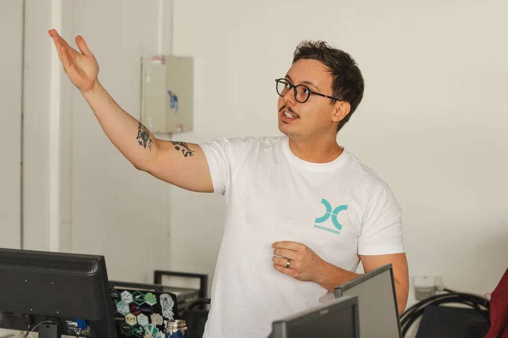
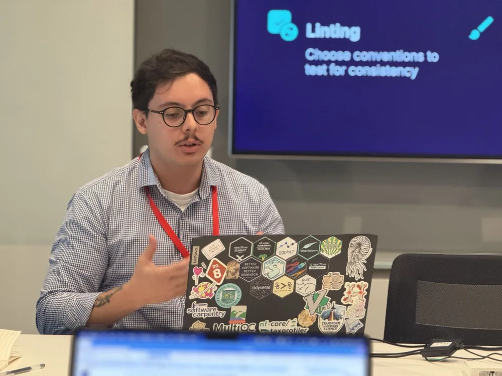

I'm a Bioinformatics Developer and a PhD student in Bioinformatics at the [Dalmolin Systems Biology Group](https://dalmolingroup.imd.ufrn.br/) (UFRN). I'm experienced with software development in Python and R, particularly in scientific software and data analysis.

I also develop courses in subjects that interest me — I've taught short courses in Docker, Git (including one at [Anaconda Learning](https://learning.anaconda.com/courses/version-control-with-git)!), and Nextflow. My interests include single-cell transcriptomics, network biology, and scientific software.

<figure>

<figcaption>Teaching Nextflow at the University of Chile, Santiago (2025)</figcaption>
</figure>
<figure>

<figcaption>Presenting my work at the Francis Crick Institute (2024)</figcaption>
</figure>

For academic inquiries, reach me at `joao.cavalcante.073 at ufrn.edu.br`, or connect with me for professional inquiries on [LinkedIn](https://www.linkedin.com/in/joao-v-cavalcante/).
