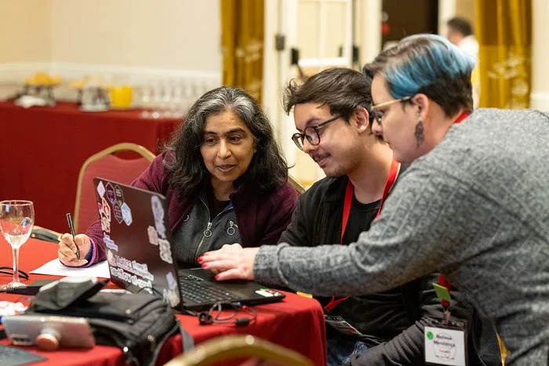

<figure>

<figcaption>Attentively looking at some error logs at the CZI Open Science LatAm meeting in Buenos Aires (2023)</figcaption>
</figure>

### [EURYALE](https://github.com/dalmolingroup/euryale)

A pipeline for taxonomic classification and functional annotation of metagenomic reads.

### [MicroView](https://github.com/dalmolingroup/microview)

A reporting tool for aggregating results from taxonomic classification analyses.

### [reconciler](https://github.com/jvfe/reconciler)

A Python interface to W3C reconciliation services.

### [go2cell](https://github.com/jvfe/go2cell)

An R package to link Gene Ontology IDs to cell types via Wikidata.

## Open Source Contributions

I also frequently contribute to open-source scientific software projects, including:

- [BioProv](https://github.com/vinisalazar/bioprov)
- [nf-core/modules](https://github.com/nf-core/modules/)
- [Biopython](https://github.com/biopython/biopython)

---

[← Back home](/)
