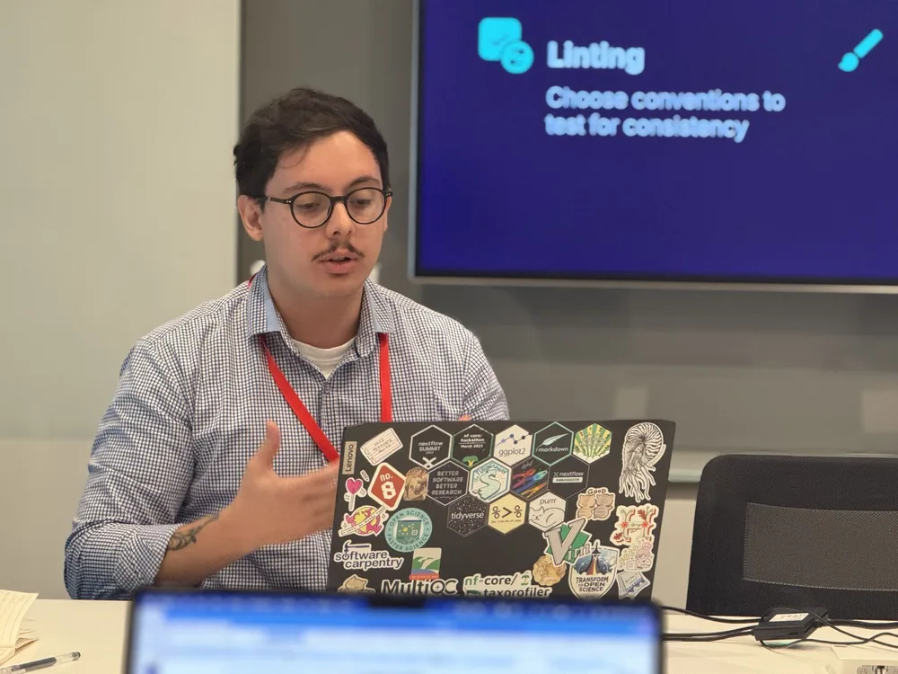

<figure>

<figcaption>Presenting my work at the Francis Crick Institute (2024)</figcaption>
</figure>

## 2025

### Bioinformatician — Sepal AI

Furthering the advance of AI in the field of bioinformatics.

## 2024

### [Future Innovators Programme — Sanger Institute](https://www.linkedin.com/company/biodev-network/)

Collaborated with the Sanger Institute's Tree of Life Infrastructure team on new features for the nf-core toolkit to enhance code reusability and collaboration, as well as facilitate the creation of new data pipelines.

### [Anaconda Learning Instructor](https://learning.anaconda.com/courses/version-control-with-git)

Worked with the Anaconda Learning platform to create a new Git course, focused on advanced Git users looking to learn more obscure features and workflows.

## 2023 – 2024

### Nextflow Developer — Dalhousie University

Worked for Dr. Robert Beiko's lab in the Faculty of Computer Science on the development of custom pipelines using Nextflow, primarily [beiko-lab/ARETE](https://github.com/beiko-lab/arete/), implementing them on SLURM HPC environments and guaranteeing their function through automated unit tests using nf-test and GitHub Actions.

## 2022 – 2023

### Bioinformatics Consultant

Worked as a freelance consultant, primarily in projects developing new bioinformatics workflows in Nextflow, WDL, and the [LatchBio platform](https://latch.bio).

## 2021

### Google Summer of Code Student Developer

Took part in the Google Summer of Code program, developing software for the R Project for Statistical Computing. Developed dashboards and data analytics platforms to analyze social media data (primarily Twitter and Meetup) to assist in decision-making.

---

[← Back home](/)
